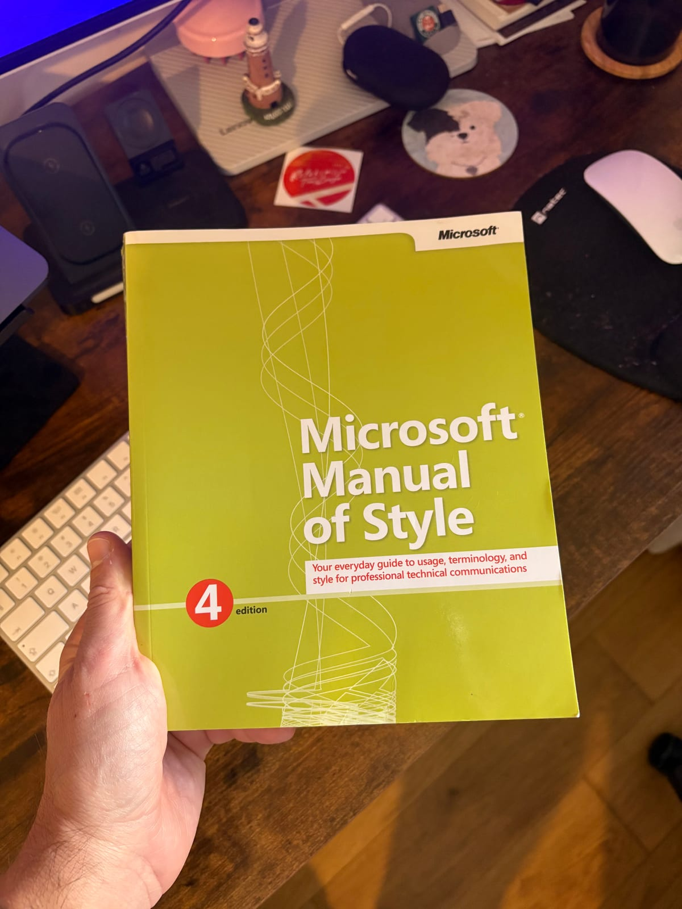

First post for Books & Places. More of a collector's item than a manual or a book. Despite being from 2012, it's still relevant in many ways, but above all it's the last printed edition of Microsoft's style manual, before it moved online as the Microsoft Writing Style Guide! It came all the way from Canada to Europe, very proud owner now!

