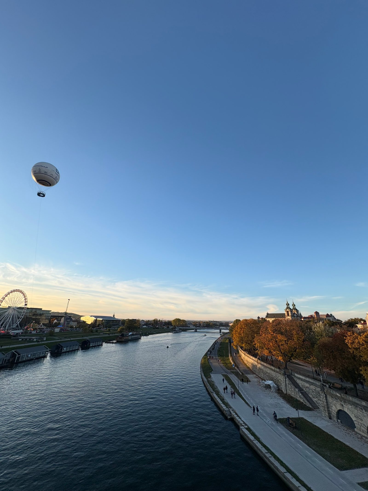
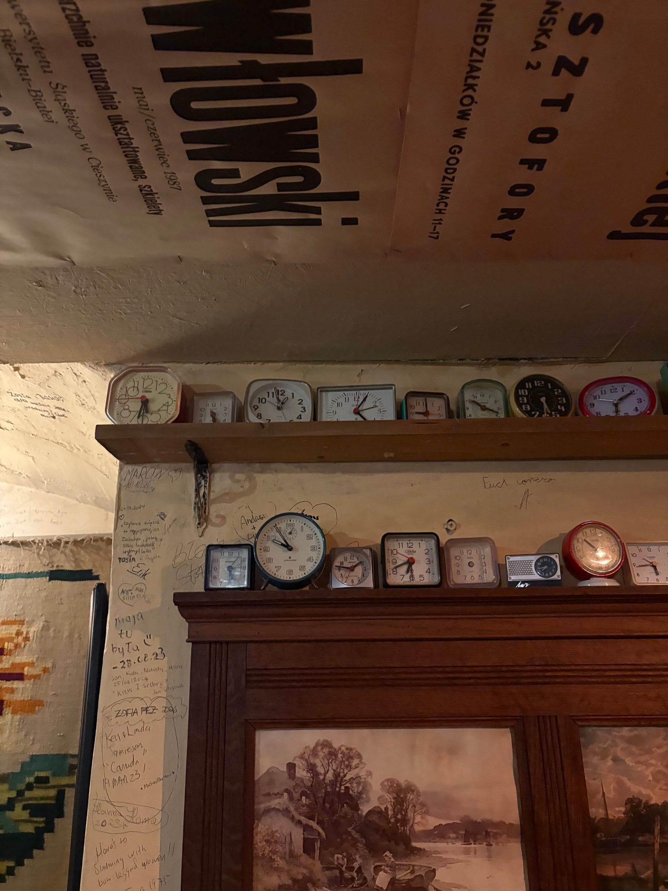

A long walk from the outskirts toward the center, watching October come to an end from a brand-new bridge, then a coffee in one of my favorite cafés in town, lots of stopped clocks on display, and a good number of projects on my mind.

