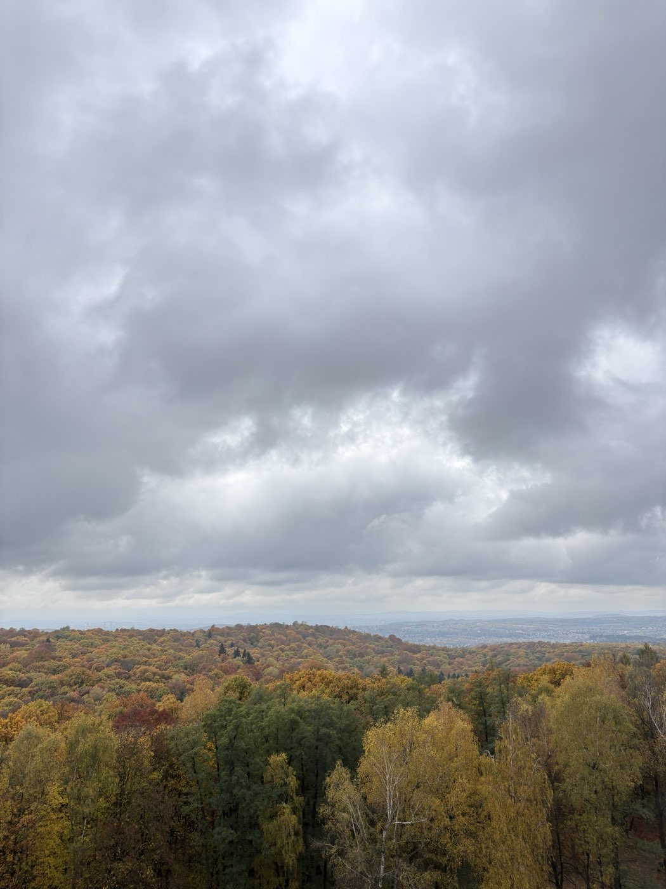
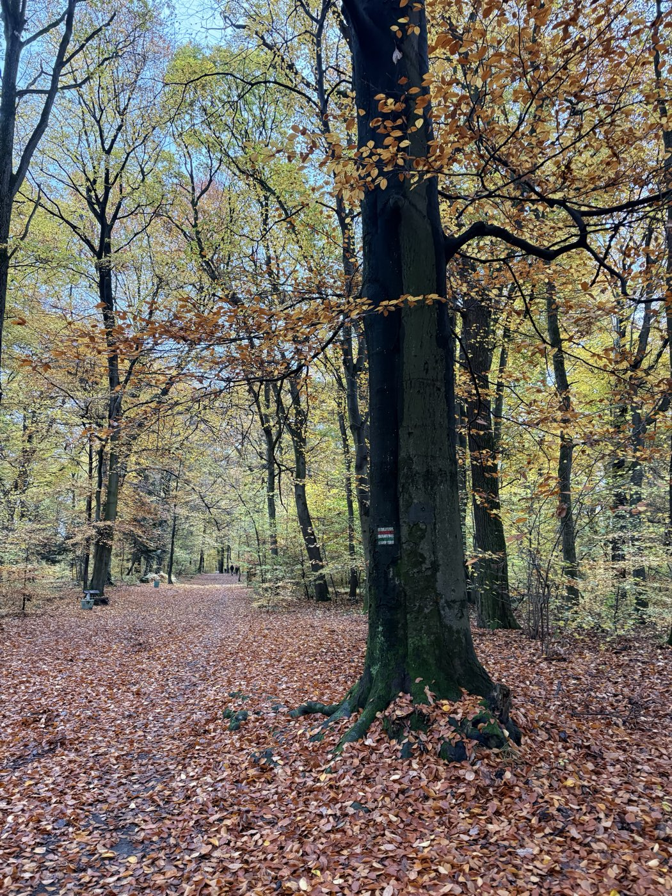
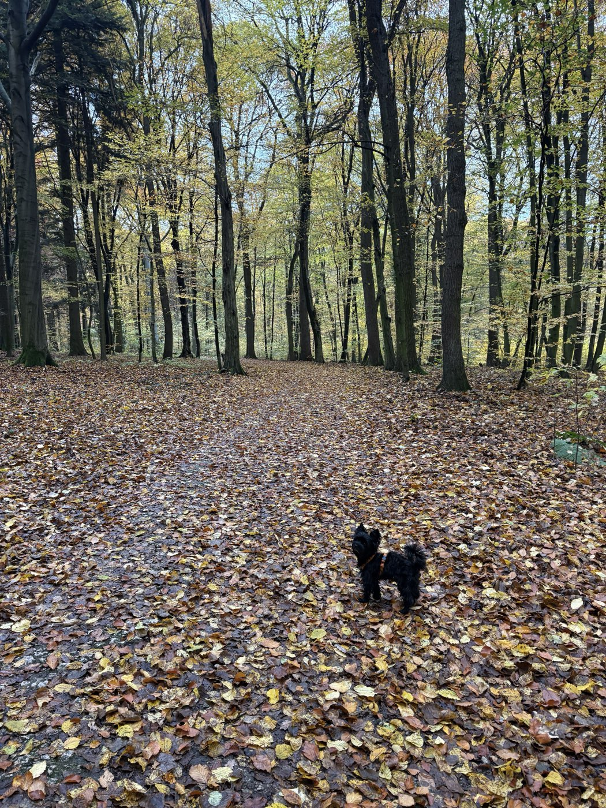

Not even a month has passed, and everything looks completely different from up here.

This time it was even more special: no trail run, just a walk with my father and my little dog.

Let's head back down. The last two months of the year ahead are going to be intense.
