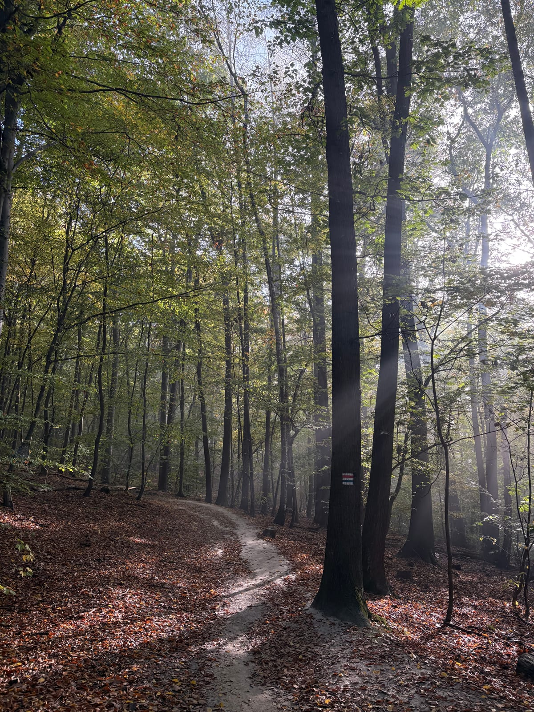
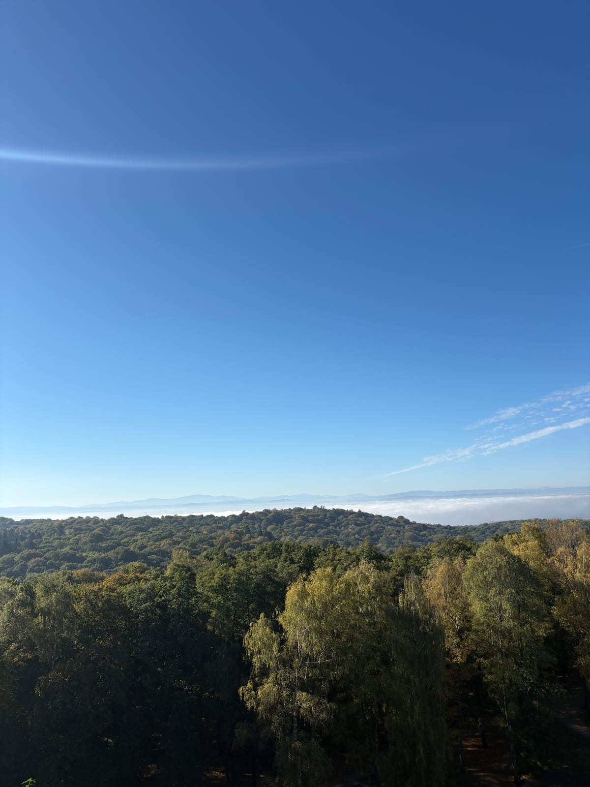

*October 17, 2026*

I missed Las Wolski in the morning, with its October colors.

Climbing a little to watch the fog lift, the sound of my steps in the leaves, a few scattered thoughts along the way.

I hope to give more time to trail running again. Let's go!
